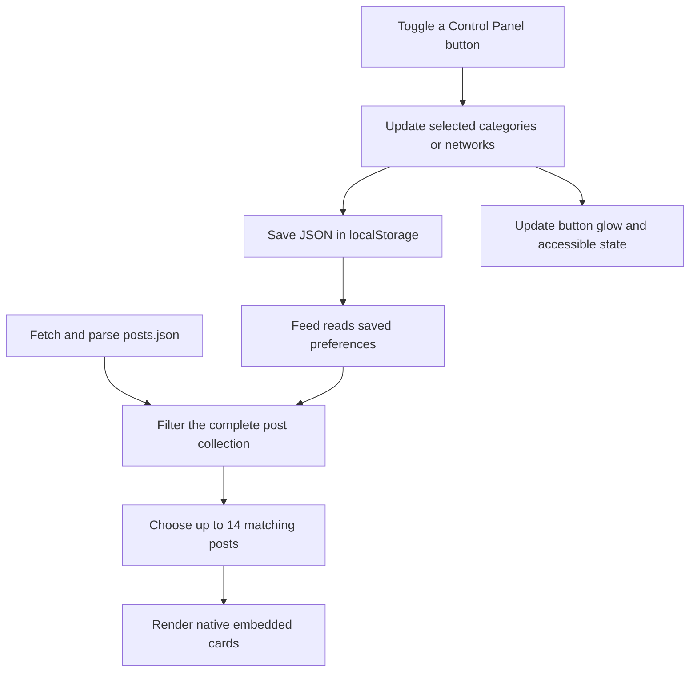

# Archie filtering and browser-side preferences

The Control Panel lets each visitor choose which categories and social networks appear in their feed. JavaScript saves those choices in the visitor’s browser and applies them when loading or shuffling posts. The feature uses the existing HTML, CSS, and JavaScript stack, with no account or backend database required.

## What changed

| File | Responsibility |
| --- | --- |
| [Sites/ControlPanel.html](Sites/ControlPanel.html) | New page with category and network buttons, selection feedback, and navigation back to the feed. |
| [Sites/control-panel.js](Sites/control-panel.js) | Reads saved selections, handles button clicks, saves changes, and updates button states. |
| [filters.js](filters.js) | Shared definitions, preference storage, validation, and post filtering. |
| [filter-icons.svg](filter-icons.svg) | Line icons for the category and network buttons. |
| [app.js](app.js) | Applies saved filters before choosing the posts displayed in each batch. |
| [toolbar.js](toolbar.js) | Swaps the hammer and wrench when the active Control Panel button is clicked, without reloading the page. |
| [styles.css](styles.css) | Control Panel layout, selected-button glow, tool animation, and responsive styles. |
| [index.html](index.html) | Adds the Control Panel button beside Help and loads the updated scripts and styles. |
| [Sites/help.html](Sites/help.html) | Adds Control Panel navigation and explains filtering and filtered shuffling. |

The Control Panel keeps the shared header and author footer. Buttons use line icons to match the existing controls. On mobile, labels are visually hidden while accessible names remain available. Reduced-motion preferences disable animated transitions.

## What the filters mean

All options start enabled when there are no saved preferences.

| Group | Options |
| --- | --- |
| Category | Satire, IT, Politics, Sport, Art, Space, Uncategorized |
| Social network | X, Mastodon, Bluesky, Threads |

**Uncategorized** represents an empty category string (`""`) in `posts.json`. It allows posts awaiting categorization to remain selectable.

Selections use **OR within each group** and **AND between groups**. For example, selecting Art and Space, together with Bluesky and Threads, means:

```text
(Art OR Space) AND (Bluesky OR Threads)
```

An Art post from Bluesky matches. An Art post from X does not. Turning off every option in either group produces an empty feed with an “Adjust filters” link.

The JSON field `SN` becomes the internal `network` value during post parsing:

| `SN` in `posts.json` | Internal filter value |
| --- | --- |
| `X` | `x` |
| `Mastodon` | `mastodon` |
| `Bluesky` | `bluesky` |
| `Threads` | `threads` |

## How selections are saved on the client

### The browser stores one small JSON value

The implementation uses `localStorage`, a browser API for storing string values across ordinary browser sessions. An object is converted to a string with `JSON.stringify()` when saving and reconstructed with `JSON.parse()` when reading. [MDN: localStorage](https://developer.mozilla.org/en-US/docs/Web/API/Window/localStorage)

The shared storage key is defined in `filters.js`:

```js
export const FILTER_STORAGE_KEY = 'archie.filters.v1';
```

A saved selection looks like this:

```json
{
  "version": 1,
  "categories": ["Art", "Space"],
  "networks": ["bluesky", "threads"]
}
```

Only enabled options are stored. Disabled options are absent from their arrays. An empty array is a deliberate selection of nothing.

The version field allows the reader to recognize the current format. The implementation accepts version `1`; other versions fall back to the defaults.

### A click updates the selection immediately

Each filter button declares which group and value it controls:

```html
<button
  data-filter-group="categories"
  data-value="Art"
  aria-pressed="true">
  Art
</button>
```

`Sites/control-panel.js` adds or removes that value from the selected array, calls `saveFilters()`, and renders the result. No separate Save button is needed.

The saving function in `filters.js` is:

```js
export function saveFilters(filters) {
  try {
    localStorage.setItem(
      FILTER_STORAGE_KEY,
      JSON.stringify({ version: 1, ...normalizeFilters(filters) })
    );
    return true;
  } catch {
    return false;
  }
}
```

`normalizeFilters()` keeps supported values in a consistent order. `render()` then sets each button’s `aria-pressed` attribute. CSS uses that attribute to apply the blue glow, keeping the visible state and accessible state aligned.

If saving fails, the Control Panel displays a message explaining that the browser could not save the selection. The on-screen buttons can still change, but those changes may not survive navigation. A later read uses the previous saved selection if it remains readable, or the defaults otherwise.

### Both pages read the same preferences

The Control Panel and feed import `readFilters()` from the same module:

```js
export function readFilters() {
  try {
    const saved = JSON.parse(localStorage.getItem(FILTER_STORAGE_KEY));
    return normalizeFilters(saved?.version === 1 ? saved : null);
  } catch {
    return normalizeFilters(null);
  }
}
```

The implementation handles these cases:

| Stored state | Result |
| --- | --- |
| No saved value, unreadable storage, invalid JSON, or unsupported version | All known options are enabled. |
| A group is missing or is not an array | All known options in that group are enabled. |
| A group contains unknown values | Unknown values are discarded. |
| A group is an empty array | That group stays empty; no posts match. |
| A valid selection exists | Only its supported options are enabled. |

## How the saved selection reaches the feed



`app.js` keeps the complete parsed collection in `sourcePosts`. `refreshFilters()` creates the eligible collection, `allPosts`, from the saved preferences. Filtering happens before cards are created:

```js
export function filterPosts(posts, filters) {
  const categories = new Set(filters.categories);
  const networks = new Set(filters.networks);
  return posts.filter(post =>
    categories.has(post.category) && networks.has(post.network)
  );
}
```

The existing batch logic then works entirely within that eligible collection:

- Display up to 14 matching posts, without duplicates inside a batch.
- Prefer unseen matching posts when shuffling.
- Fill a short unseen remainder with previously seen matching posts.
- Avoid the previous batch when enough alternatives exist.
- Show fewer than 14 cards when fewer than 14 posts match.

Changing filters rebuilds the unseen queue. Reloading the feed also starts a new queue. Filter choices are persistent; the history of which posts have been seen is kept only in the current page’s memory.

The browser still downloads the complete `posts.json` file. Filtering controls which cards are created; it does not restrict access to the underlying post list. Saving a preference does not modify `posts.json` or send the selection to an application server. Native embeds continue to make their own network requests.

## Returning to the feed and using multiple tabs

Both pages listen for `pageshow` and reread preferences. This covers returning with Back or Forward, including when the browser restores a cached page. [MDN: pageshow](https://developer.mozilla.org/en-US/docs/Web/API/Window/pageshow_event)

They also listen for `storage` events for `archie.filters.v1`, or a cleared storage area. This lets an already-open feed respond when the Control Panel changes preferences in another tab on the same origin. The event is delivered to other documents, not the document performing the write; the Control Panel updates itself directly after its own click handler saves. [MDN: storage event](https://developer.mozilla.org/en-US/docs/Web/API/Window/storage_event)

`refreshFilters()` compares the normalized selection with its last applied value to avoid rebuilding an unchanged feed. If a shuffle animation is running, it defers the refresh until the shuffle’s `finally` block.

## Where the preferences live

Storage belongs to the browser profile and the page’s **origin**: protocol, hostname, and port. Page paths do not separate it. Thus `/index.html` and `/Sites/ControlPanel.html` share preferences when served from the same origin. [MDN: localStorage](https://developer.mozilla.org/en-US/docs/Web/API/Window/localStorage)

These are separate storage locations:

```text
http://localhost:8000
http://localhost:8001
http://127.0.0.1:8000
https://aggregate.mk
```

There is no application-level synchronization between devices or browser profiles. Clearing site data removes the saved preference. Private-browsing storage is temporary, and browser policies can prevent storage access. Direct `file://` storage behavior is unreliable; use the site through HTTP or HTTPS. [MDN: localStorage](https://developer.mozilla.org/en-US/docs/Web/API/Window/localStorage)

For local development, run this from the project folder:

```bash
python3 -m http.server 8000
```

Open `http://localhost:8000/`. Python only serves the static files; the browser’s JavaScript handles filtering and persistence.

## Inspecting and resetting saved filters

Open the browser’s developer console while visiting the site. Inspect the stored selection with:

```js
JSON.parse(localStorage.getItem('archie.filters.v1'))
```

Reset just Archie’s filters, then reload the current page:

```js
localStorage.removeItem('archie.filters.v1');
location.reload();
```

The next read returns all filters enabled. Reloading also updates the tab where the key was removed, since that tab does not receive its own `storage` event.

## Extending the available filters

Category buttons are currently defined explicitly; they are not generated from `posts.json`. To add a category, update `CATEGORIES` in `filters.js`, add a matching button in `Sites/ControlPanel.html`, and add its icon to `filter-icons.svg`.

Keep the category value identical across the JSON data, shared definition, and button’s `data-value`. Category matching is case-sensitive after the post parser trims surrounding whitespace. An unlisted category will not match the current filters.

A new option is enabled by default for visitors without saved preferences. Existing saved arrays will not contain it, so those visitors must turn it on unless a migration is added. Supporting another social network also requires extending URL parsing and native embed loading in `embeds.js`.

## Verification completed during implementation

Checks covered category/network combinations, saved selections after reload, Back navigation, updates between tabs, filtered shuffle batches, empty groups, uncategorized posts, and recovery from invalid storage. Browser checks also covered keyboard controls, tool swapping without navigation, selected-button glow, reduced motion, and layouts from 280 to 1280 pixels wide.

Native providers were mocked during browser checks. These checks validate the local UI and filtering behavior; they do not verify that every external post is currently available.
